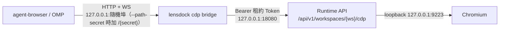

# SPIKE-04：CDP Bridge

結論：**租約控管的 CDP 路徑可用。** 撤銷、TTL 到期、Browser 重啟都會在 1 秒內關閉既有連線（4001／4002）。舊 Token、舊 Epoch、舊 Generation 都會被拒。Bridge 預設在根路徑提供 Discovery，agent-browser 0.39.2 與 OMP 18.12.6 都能直接接；`--path-secret` 嚴格模式保留隨機路徑前綴，agent-browser 給完整 WS URL 也通過。

對應驗收：CT-03（WebSocket 部分）、CT-10、RT-03 在兩台主機通過（`orb-final-20261024T155400Z`、`nuci3-final-20261024T155601Z`）。Code Review 修正後（Bridge 根路徑模式、CT-03 f、鎖定結束租約）只在 OrbStack 重跑（`orb-review2-20261024T183602Z`），nuci3 未重跑。agent-browser 與 OMP 只在 macOS 開發機測。版本矩陣同 [SPIKE-01](SPIKE-01-sandbox.md#版本矩陣)。

## 路徑

- **Runtime**（M0 兼任 Gateway）：驗證 AGENT 租約；只允許 `GET /json`、`/json/list`、`/json/version`、`/json/protocol`、`/json/activate/{id}`、`/json/close/{id}`、`PUT /json/new` 與 `/devtools/{browser,page}/{id}` WebSocket；拒絕帶 `Origin` 的請求；改寫 Discovery 內的 WebSocket URL；轉發時拒絕 `Browser.close`、`Browser.crash`、`Browser.crashGpuProcess`、`Target.exposeDevToolsProtocol` 與整個 `Extensions.` Domain（回 -32000，連線不斷）。
- **Bridge**：只能聽 loopback（`--listen` 只接受 `127.0.0.1`／`localhost`），檢查 `Host` 與 `Origin`；預設在根路徑服務，`--path-secret` 時 URL 帶 32 bytes 隨機路徑前綴（兩種模式的取捨見 [AGENT-INTEGRATION](../AGENT-INTEGRATION.md#2-cli-介面)）。每 TTL/3 續約。租約失效時關閉所有 Client 並以 exit code 3 結束。HUMAN 租約或非 loopback 位址直接 exit 2。

## CT-03：撤銷與世代

| 情境 | 關閉碼 | OrbStack | nuci3 |
|---|---|---|---|
| 釋放租約，既有 WS | 4001 | 0 ms | 0 ms |
| TTL（10 秒）到期 | 4001 | 10.007 s | 10.005 s |
| SIGKILL Chromium → 新 Generation | 4002 | 49 ms | 98 ms |
| 撤銷時經 Bridge 的 Client | 4001，Bridge exit 3 | 0 ms | 1 ms |

舊 Token（租約已結束）的 HTTP 與 WebSocket 請求回 409 `LEASE_ENDED`；以舊 Epoch 或其他 Generation 續約回 412 `EPOCH_MISMATCH`／`GENERATION_MISMATCH`。

Runtime 進入 ERROR_LOCKED（例如 VNC 或 Xvfb 掛掉）時，持有中的租約直接結束（原因 `LOCKED`，WebSocket 4001），鎖定期間續約一律回 409 與鎖定代碼。Chromium 自己結束時，Supervisor 先換 Generation 再鎖定，所以持有者收到的是 4002（Browser 狀態已遺失），不是 4001。這兩條路徑由單元測試涵蓋；e2e 只測了 Chromium 被 SIGKILL 的 4002。

## CT-10：狀態表

`TestCT10` 在「無租約／HUMAN 租約／AGENT 租約／AGENT 結束後」四種狀態下打所有路由，結果存成 `TestCT10/status-table.json`，兩台全符合預期。另外確認：

- `docker port` 只有 `8080/tcp -> 127.0.0.1:18080`。macOS 上 `127.0.0.1:5900` 能連，那是系統的螢幕共享（launchd），不是 Container。
- 被拒的 CDP 方法不會中斷連線，之後 `Browser.getVersion` 仍正常。

## RT-03：關閉 Agent 端不影響 Browser

經 Bridge 在頁面輸入表單後，關閉 CDP Client、釋放租約、結束 Bridge。再取新的 AGENT 租約時，頁面標題與表單值都在，Chromium PID 與 Runtime Generation 不變。

發現：Bridge 在沒有 Client 連著時，要到下一次續約（TTL/3，限制在 10～120 秒之間；CLI 預設 TTL 30 秒時是 10 秒）才會發現租約已釋放並結束。這段時間內的新連線，Runtime 一律以 409 拒絕，所以不是權限漏洞，只是 Bridge 晚一點退出。

## agent-browser 0.39.2

`tests/e2e/agent-browser.sh` 同一個租約開兩個 Bridge：預設模式用 `--cdp <埠號>`，`--path-secret` 模式用完整 `browserWebSocketUrl`：

| 步驟 | 結果 |
|---|---|
| `tab list`、`eval document.title`（埠號，預設模式）；`snapshot`（完整 WS URL，`--path-secret`） | PASS |
| 撤銷後兩個 Bridge 都 exit 3 | PASS |
| 撤銷後下一個命令失敗（`Connection refused`） | PASS |
| 沒有啟動本機 Browser | PASS |
| `close` | PASS |

## OMP 18.12.6（eval `browser` API）

| `app.cdp_url` | 結果 |
|---|---|
| 預設模式 `discoveryUrl`（`http://127.0.0.1:<port>`） | PASS：開頁、讀標題與內容、關閉 |
| `--path-secret` 的 `discoveryUrl`（帶前綴） | 失敗：OMP 自己的探測保留路徑，但接著用 Puppeteer `connect({browserURL})`，而 puppeteer-core 25.3.0 以 `new URL('/json/version', browserURL)` 組 URL，前綴被丟掉，404 |
| `browserWebSocketUrl`（`ws://`） | OMP 拒收：只接受 HTTP Discovery Endpoint |

預設模式撤銷也正常：Bridge 在 release 後 1 ms 內 exit 3，OMP 下一個命令失敗（`detached Frame`）。證據：`tests/e2e/out/orb-review2-20261024T183602Z/omp/result.json`。帶前綴與 `ws://` 兩列是上一輪（`orb-final-20261024T155400Z`）的結果；這部分 Bridge 行為沒變，本輪未重測。

要讓 OMP 也能用 `--path-secret`，需要 OMP 改成用探測拿到的 `webSocketDebuggerUrl` 呼叫 `connect({browserWSEndpoint})`，或接受 `ws://`。已起草給 OMP 的 Issue，尚未送出。

## 未驗證

- Codex、Claude Code 的實際接法（相容矩陣其他列）。
- `/json/new` 未限制 URL Scheme，`file:`、`javascript:` 會照轉；`Target.sendMessageToTarget` 未在拒絕清單。M1 Gateway 要補。
- 5900 VNC 尚未納入租約控管（只在 loopback）。

## 2026-10-25 補註（整合版）

上面的結果與「未驗證」清單是 2026-10-24 的 M0 狀態。整合版（Gateway 在前、Runtime 不發布埠）的補充，證據是私有檔案：

- Claude Code 2.1.310 與 Codex CLI 0.164.0（用 `npx` 固定版本；本機安裝版有無關的 dyld 當機）完成了讀圖與 ACK 的交接，OMP CLI 與 CDP 路徑也測過。這是個別路徑的結果，不是整個相容矩陣；細節與限制見 [ACCEPTANCE.md](../ACCEPTANCE.md#evidence-status) 的 FB-04。
- 整合版 Gateway 對只有身分、沒有 AGENT 租約的泛用 CDP 回 403 `LEASE_REQUIRED`（`gateway-denials.json`）。
- `/json/new` 的 URL Scheme 限制與 `Target.sendMessageToTarget` 在整合版沒有紀錄驗證，仍視為未驗證。
